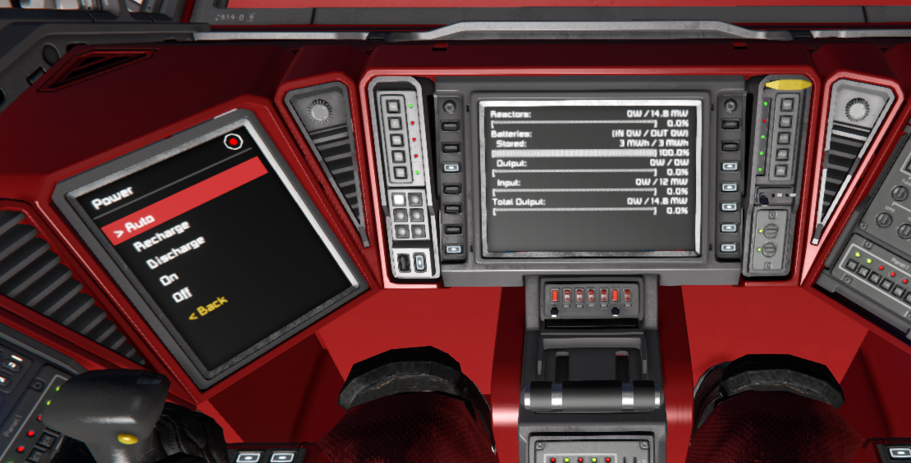
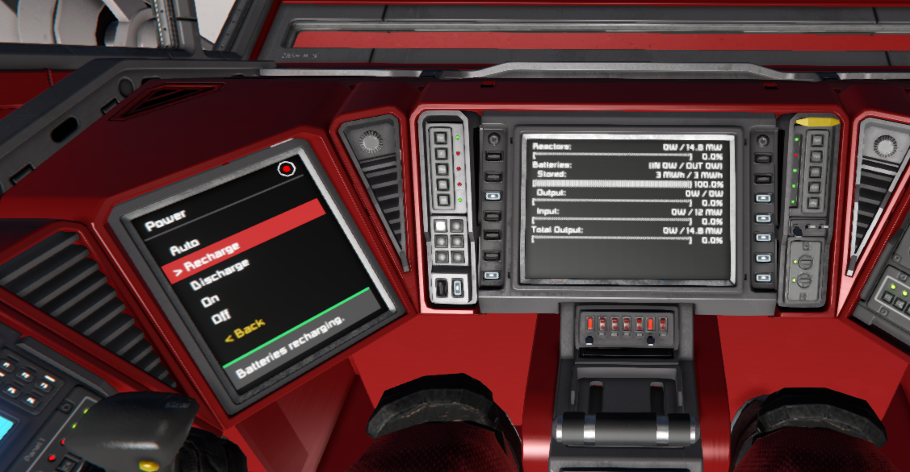

# Announcements

<!-- [[toc]] -->

---

<!-- Add new announcements below this line, with the most recent at the top -->

## 2nd October Update

This second update for October brings **Mother OS 1.3.0**, **Mother Core 1.2.0**, **Mother GUI 0.3.0**, and **Mother Autopilot System (MAPS) 0.3.0**. Your constructs can now make decisions. Conditional logic lets any script react to the state of your blocks (`"Batteries" low`, `grid altitude < 100`) with `when` rules and `if` steps, and every script on the construct shares the same vocabulary. Update all of your scripts at the same time so they run the same version of Mother Core. Mother Core has also grown a bit, so for developers, you may need to prune a bit. Have no fear though, I have pruned Core considerably and the build tools go well beyond what standard MDK2 minification can do.

::: warning Breaking change: connector commands
`connector/lock`, `connector/unlock` and `connector/toggle` are no longer part of Mother Core. Mother OS still provides them, but Mother GUI and MAPS do not. Developers building on Mother Core should register these commands from their own module.
:::

### Release Highlights

- **Conditional logic** adds polled `when` rules, inline `if` / `elseif` / `else` / `end` steps, text compare, and a `[predicates]` section for defining your own predicates.
- **Shared vocabulary** lets a script use conditions that only another script defines. Mother GUI can test MAPS's `inspace`, and MAPS can test Mother OS's `low`, with nothing extra to configure.
- **Mother OS 1.3.0** registers block properties and predicates for batteries, tanks, jump drives, doors, landing gear, pistons, rotors, sensors, cockpits, air vents and thrusters. It also adds a `--backup` option to `battery/charge` and `$VARIABLES` in autolcd views.
- **MAPS 0.3** adds `speed`, `moving`, `gravity`, `altitude`, `inspace` and `ingravity`.
- **Mother GUI 0.3** refreshes displays more reliably on multiplayer servers.
- **Mother Core 1.2** new block command registration syntax to make wiring up commands easier for developers (and also save a ton of characters).

### Conditional Logic

A condition is a target followed by a `predicate`, or by a `property`, an operator and a value. Use it in a `when` rule to run a routine when the condition changes, or in an `if` step to branch inside any routine.

```ms title="Mother > Custom Data"
; Change these values to match your block and group names.
[variables]
SCREEN="Cockpit:1"
BATTERIES=Batteries
CONNECTOR="Main Connector"

; When our batteries are low, we print to a cockpit screen.
[rules]
LowPower=
| when $BATTERIES low;
|   screen/print $SCREEN "Power is low";
| else;
|   screen/print $SCREEN "Power OK";

; Run docking procedure if connector ready to connect, 
; or notify the user.
[commands]
Dock=
| if $CONNECTOR connectable;
|   connector/lock $CONNECTOR;
| else;
|   view/notify $SCREEN "Cannot lock. No connector detected." --level=error;
| end;
```

`$NAME` is replaced with the value from `[variables]`, so you only edit your block names in one place. The examples below use the same pattern.

Indent the steps under each `when`, `if`, `elseif` and `else` to make the nesting easy to read. Spaces after the `|` are ignored. Every `if` needs its own `end;`, so put `else;` and `end;` in the same column as the `if` they belong to.

Predicates are the names you can use after a target. Each script defines the predicates for the blocks it owns, and shares them with every other script on the construct. Select a tab to see what is available in each script. You can add your own, or change a built-in one, in the `[predicates]` section of the programmable block's Custom Data.

::: tabs

@tab Mother Core

Available in every script, including Mother GUI.

| Block | Predicates | Properties | State words |
|---|---|---|---|
| Any functional block | `on`, `off` | `enabled` | |
| Any block | `working`, `broken` | `working` | |
| Connector | `connected`, `connectable`, `disconnected` | `status` | `unconnected`, `connectable`, `connected` |

@tab Mother OS

| Block | Predicates | Properties | State words |
|---|---|---|---|
| Battery | `low` (under 20%), `critical` (under 10%), `empty` (under 2%), `full` (over 98%), `ready` (over 99%) | `charge`, `mode` | `auto`, `recharge`, `discharge` |
| Jump drive | `low`, `critical`, `empty`, `full`, `ready` (same as batteries) | `charge`, `status` | `charging`, `jumping`, `ready` |
| Gas tank | `low` (under 15%), `critical` (under 10%), `empty` (under 2%), `full` (over 98%), `stockpiling` | `fill`, `stockpile` | |
| Air vent | `low` (oxygen under 50%) | `oxygen`, `status` | `pressurized`, `pressurizing`, `depressurized`, `depressurizing` |
| Door | | `status` | `open`, `opening`, `closed`, `closing` |
| Landing gear | `ready`, `locked`, `unlocked` | `status` | `readytolock`, `locked`, `unlocked` |
| Piston | | `position`, `status` | `extending`, `extended`, `retracting`, `retracted`, `stopped` |
| Rotor and hinge | `locked`, `unlocked` | `angle` (degrees), `locked` | |
| Rotor, hinge and piston | `attached`, `detached` | `attached` | |
| Sensor | `detected`, `clear` | `detected`, `distance` | |
| Cockpit and other ship controllers | `occupied`, `empty` | `occupied`, `dampeners`, `handbrake` | |
| Thruster | `weak` (effectiveness under 30%) | `effectiveness` | |

Predicates with the same name mean the same idea on each block, so `"Batteries" low`, `"Hydrogen Tanks" low` and `"Airlock Vent" low` all read naturally. In a group of mixed blocks, only blocks that define the predicate are tested. `low` and `critical` use a built-in buffer so they do not flicker around the limit (5% and 3%). Change any of them in `[predicates]`.

`dampeners` and `handbrake` have no predicate. Compare them to `1` (on) or `0` (off), for example `when grid dampeners == 0;`. Every state word also works as a predicate.

@tab MAPS

| Block | Predicates | Properties | State words |
|---|---|---|---|
| Grid (cockpit or remote control) | `moving` (faster than 0.1 m/s), `stopped`, `inspace` (no gravity), `ingravity` | `speed`, `gravity`, `altitude` (above the planet surface) | |

Use `grid` as the target, for example `if grid altitude < 100;`.

@tab Mother GUI

Mother GUI does not define its own predicates. It uses every predicate from Mother Core, and from Mother OS and MAPS when they run on the same construct, so a menu can react to the state of your ship.

```ms title="Mother GUI > Custom Data"
[variables]
SCREEN="Cockpit:1"
BATTERIES=Batteries

[rules]
Alert=
| when $BATTERIES critical;
|   view/notify $SCREEN "Batteries critical" --level=error;
```

:::

#### Common Recipes

Rules go in the `[rules]` section of the programmable block's Custom Data. Commands and menu entries can use `if` directly. Rules run when a condition changes, so a rule only fires when its condition goes from false to true, and its optional `else;` branch fires when it goes back to false. Replace the quoted block and group names with your own.

::: tabs

@tab Airlock

Two commands cycle the airlock, and each step checks that the previous one worked before moving on. The inner door must be closed before the vent depressurizes, and the vent must be depressurized before the outer door opens. Two rules act as an interlock, so both doors can never be open at the same time, even if a player opens one by hand.

```ms title="Mother OS > Custom Data"
[variables]
SCREEN="Cockpit:1"
DOOR_INNER="Airlock Inner"
DOOR_OUTER="Airlock Outer"
VENT="Airlock Vent"

[commands]
AirlockExit=
| door/close $DOOR_INNER;
| wait 2;
| if $DOOR_INNER closed;
|   vent/depressurize $VENT;
|   wait 5;
|   if $VENT depressurized;
|     door/open $DOOR_OUTER;
|   else;
|     view/notify $SCREEN "Airlock is still depressurizing." --level=warning;
|   end;
| else;
|   view/notify $SCREEN "Inner door is blocked." --level=error;
| end;

AirlockEnter=
| door/close $DOOR_OUTER;
| wait 2;
| if $DOOR_OUTER closed;
|   vent/pressurize $VENT;
|   wait 5;
|   if $VENT pressurized;
|     door/open $DOOR_INNER;
|   else;
|     view/notify $SCREEN "Airlock is still pressurizing." --level=warning;
|   end;
| else;
|   view/notify $SCREEN "Outer door is blocked." --level=error;
| end;

[rules]
InterlockOuter=
| when $DOOR_OUTER open;
|   door/close $DOOR_INNER;

InterlockInner=
| when $DOOR_INNER open;
|   door/close $DOOR_OUTER;
```

@tab Landing Lights

Turn the landing lights on when the ship drops below 100 m, and off again when it climbs. `--buffer=20` keeps the lights from flickering when you hover near 100 m, so they only switch off above 120 m. `--for=2` waits for two seconds before reacting. `altitude` has no value in space, so the lights stay off there. A second rule parks the ship when the landing gear locks: the batteries charge (keeping one in auto mode) and the tanks stockpile.

```ms title="Mother OS > Custom Data"
[variables]
LIGHTS="Landing Lights"
GEAR="Landing Gear"
BATTERIES=Batteries
BACKUP_BATTERY=BackupBattery
TANKS="Hydrogen Tanks"

[rules]
LandingLights=
| when grid altitude < 100 --buffer=20 --for=2;
|   block/on $LIGHTS;
| else;
|   block/off $LIGHTS;

Parked=
| when $GEAR locked --for=2;
|   block/off $LIGHTS;
|   battery/charge $BATTERIES --backup=$BACKUP_BATTERY;
|   tank/stockpile $TANKS;
| else;
|   battery/auto $BATTERIES;
|   tank/share $TANKS;
```

`altitude` is provided by MAPS. Mother OS can use it without any setup as long as MAPS runs on the same construct.

@tab Space Transition

Switch engine groups when the ship leaves a planet's gravity. Atmospheric thrusters do nothing in space, so turn them off and bring the hydrogen thrusters online, then reverse it on the way back in. `--for=3` stops the switch from firing while the ship skims the edge of the atmosphere.

```ms title="Mother OS > Custom Data"
[variables]
SCREEN="Cockpit:1"
THRUSTERS_ATMOSPHERIC="Atmospheric Thrusters"
THRUSTERS_HYDROGEN="Hydrogen Thrusters"

[rules]
Atmosphere=
| when grid inspace --for=3;
|   block/off $THRUSTERS_ATMOSPHERIC;
|   block/on $THRUSTERS_HYDROGEN;
|   view/notify $SCREEN "Entered space." --level=info;
| else;
|   block/on $THRUSTERS_ATMOSPHERIC;
|   block/off $THRUSTERS_HYDROGEN;
|   view/notify $SCREEN "Entered gravity." --level=info;
```

`inspace` is only true when there is no gravity at all. To switch earlier, compare the `gravity` property in m/s² instead (the ship's gravity is about 9.8 at 1 g):

```ms title="Mother OS > Custom Data"
[variables]
THRUSTERS_ATMOSPHERIC="Atmospheric Thrusters"
THRUSTERS_HYDROGEN="Hydrogen Thrusters"

[rules]
Atmosphere=
| when grid gravity < 2 --buffer=1 --for=3;
|   block/off $THRUSTERS_ATMOSPHERIC;
|   block/on $THRUSTERS_HYDROGEN;
| else;
|   block/on $THRUSTERS_ATMOSPHERIC;
|   block/off $THRUSTERS_HYDROGEN;
```

`inspace`, `ingravity` and `gravity` are provided by MAPS, so the rule works in Mother OS or Mother GUI as long as MAPS runs on the same construct.

@tab Docking

React to the connector instead of writing a hook for every state. Once the ship is docked, charge the batteries (keeping one in auto mode as a backup) and stockpile the tanks. When it leaves, go back to normal. `--for=2` ignores a connector that briefly connects while you manoeuvre.

```ms title="Mother OS > Custom Data"
[variables]
DOCK=Dock
BATTERIES=Batteries
BACKUP_BATTERY=BackupBattery
TANKS="Hydrogen Tanks"
THRUSTERS="Hydrogen Thrusters"

[rules]
Docked=
| when $DOCK connected --for=2;
|   battery/charge $BATTERIES --backup=$BACKUP_BATTERY;
|   tank/stockpile $TANKS;
|   block/off $THRUSTERS;
| else;
|   battery/auto $BATTERIES;
|   tank/share $TANKS;
|   block/on $THRUSTERS;
```

A command can also check a connector before it does something:

```ms title="Mother OS > Custom Data"
[commands]
Undock=
| if $DOCK connected;
|   connector/unlock $DOCK;
|   wait 1;
| end;
| block/on $THRUSTERS;
```

@tab Low Power

Warn early, then save power when it gets critical. `low` and `critical` already include a built-in buffer, so these rules will not flicker. `--at` changes the threshold for a single rule, here warning at 25% instead of 20%.

```ms title="Mother OS > Custom Data"
[variables]
SCREEN="Cockpit:1"
BATTERIES=Batteries
SPOTLIGHTS=Spotlights
PROJECTORS=Projectors

[rules]
LowBattery=
| when $BATTERIES low --at=25%;
|   view/notify $SCREEN "Batteries low." --level=warning;
| else;
|   view/notify $SCREEN "Batteries recovered." --level=success;

PowerSaver=
| when $BATTERIES critical --for=3;
|   block/off $SPOTLIGHTS;
|   block/off $PROJECTORS;
|   view/notify $SCREEN "Power saver on." --level=error;
| else;
|   block/on $SPOTLIGHTS;
|   block/on $PROJECTORS;
```

@tab Menu Toggle

Use `if` in a menu entry to replace separate On and Off buttons with a single one. Because `on` and `off` are predicates for any functional block, this works for lights, doors, thrusters and more.

```ms title="Mother GUI > Custom Data"
[variables]
SCREEN="Cockpit:1"
HEADLIGHTS=Headlights

[menu:Lighting]
Headlights=
| if $HEADLIGHTS on;
|   block/off $HEADLIGHTS;
|   view/notify $SCREEN "Headlights off." --level=success;
| else;
|   block/on $HEADLIGHTS;
|   view/notify $SCREEN "Headlights on." --level=success;
| end;
```

@tab Confirm Menu

Ask before anything you cannot easily undo. A confirm menu is a normal menu with two entries. The entry that starts the action opens it with `view/go self`, and `--title` shows the question in the header. List `No` first for risky actions so the cursor starts on the safe choice, and use `view/back` to return to the previous menu.

```ms title="Mother GUI > Custom Data"
[variables]
SCREEN="Cockpit:1"
SYSTEMS="Non-Essential Systems"

[menu:Systems]
Power Down=
| view/go self ConfirmPowerDown --title="Power down?";

[menu:ConfirmPowerDown]
No, cancel=
| view/back;
Yes, power down=
| block/off $SYSTEMS;
| view/notify $SCREEN "Systems off." --level=success;
| view/back;
```

The same menu works for other actions such as purging storage or halting running routines. Point each action at its own confirm menu.

:::

Explore Mother OS: [Conditional Logic](./IngameScript/ConditionalLogic.md) | [Examples](./IngameScript/Examples.md#conditional-logic) | [Jump Drive Module](./IngameScript/Modules/Extension/JumpDriveModule.md) | [Upgrade Guide](./IngameScript/UpgradeGuide.md)

Explore Mother Core: [Conditions](./Framework/Developer/CoreModules/Conditions.md) | [Managing Script Size](./Framework/Developer/GettingStarted/ManagingScriptSize.md#build-time-optimization) | [Upgrade Guide](./Framework/Developer/GettingStarted/UpgradeGuide.md)

Explore Mother GUI: [Conditional Menu Entries](./MotherGUI/MenuView.md#conditional-menu-entries) | [Upgrade Guide](./MotherGUI/UpgradeGuide.md)

Explore Mother Autopilot System (MAPS): [Conditions](./MotherAutopilotSystem/Modules/FlightControlModule.md#conditions) | [Upgrade Guide](./MotherAutopilotSystem/UpgradeGuide.md)

---

## October 2026 Update

This update brings **Mother OS 1.2**, **Mother Core 1.1.4**, **Mother GUI 0.2**, and **Mother Autopilot System (MAPS) 0.2**. It adds Automatic LCDs 2 support, in-menu notifications, and lets scripts share screens with each other. There are no breaking changes, but update all of your scripts at the same time so they run the same version of Mother Core.

### Release Highlights

- **Mother OS 1.2** adds the `autolcd/print` and `autolcd/clear` commands, and expands `screen/print` with `bgcolor`, `alignment` and `padding` options. Sorters gain `sorter/mode`, `sorter/add`, `sorter/remove` and `sorter/clear` for managing item filters.
- **Mother Core 1.1.4** adds the `halt` command, shared views between scripts, quoted option values, and fixes for merge and unmerge handling.
- **Mother GUI 0.2** adds the `view/notify` command, custom menu titles, scroll indicators, and a simpler `< Back` entry on every menu.
- **MAPS 0.2** shares `MapView` with Mother GUI so one screen can switch between a menu and the map.

Check out the [Nova Blade Mk1 (Steam Workshop](https://steamcommunity.com/sharedfiles/filedetails/?id=3823300552) - designed as a demonstration aircraft for the synergy of Mother OS, Mother GUI and Mother Autopilot System, all built using [Mother Core](./Framework/README.md).

<iframe width="100%" height="400" src="https://www.youtube.com/embed/UJhYhdJwrFQ" title="YouTube video player" frameborder="0" allow="accelerometer; autoplay; clipboard-write; encrypted-media; gyroscope; picture-in-picture; web-share" referrerpolicy="strict-origin-when-cross-origin" allowfullscreen></iframe>


### Mother OS 1.2

Players can now show [Automatic LCDs 2](https://steamcommunity.com/sharedfiles/filedetails/?id=822950976) views on any screen with a single command. Define named views in the `[autolcd]` section of the programmable block, then print them to a screen. Use `autolcd/clear` to remove config from a screen.

```ms title="Mother > Custom Data"
[commands]
ShowPowerView=autolcd/print "Cockpit:1" PowerView

[autolcd]
PowerView=
| Power {T:*}
| Working {TG:Batteries}
```



Conveyor sorters now support filtering. Switch a sorter between whitelist and blacklist with `sorter/mode`, and manage its filter list with `sorter/add`, `sorter/remove` and `sorter/clear`. Items are written as `Type/Subtype` (such as `Ore/Iron`), or as a type alone (such as `Ore`) to match every item of that type. `sorter/add` accepts `--fresh` and `--mode` so a sorter can be fully reconfigured in a single command.

```ms title="Terminal"
sorter/add "Cargo Sorter" Ore/Stone Ore/Ice --fresh --mode=blacklist;
```

Explore Mother OS: [AutoLCD Module](./IngameScript/Modules/Extension/AutoLCDModule.md) | [Sorter Module](./IngameScript/Modules/Extension/SorterModule.md) | [Upgrade Guide](./IngameScript/UpgradeGuide.md)

### Mother GUI 0.2

Mother GUI can now give feedback to the player and is a bit easier to use. Use `view/notify` to show a transient message in the footer of a view, and `--title` with `view/go` to replace the header of a menu. Menus show scroll indicators when they overflow, use a larger and more readable font, and every menu with history shows a `< Back` option. Rather than nesting multiple menu layers, this simplifies a modular menu structure with navigation history.

```ms title="Terminal"
view/notify "Cockpit:1" "Docking complete" --level=success --duration=5;
view/go "Cockpit:1" MapMenu --title="Map Menu Title";
```



Explore Mother GUI: [Notifications](./MotherGUI/MenuView.md#notifications) | [MenuView](./MotherGUI/MenuView.md)

### Mother Autopilot System 0.2

`MapView` can now be opened from Mother GUI. A cockpit screen can show a menu, switch to the map with `view/go`, and return with `view/back`.

Explore MAPS: [Map Module](./MotherAutopilotSystem/Modules/MapModule.md#switching-between-the-map-and-mother-gui) | [Upgrade Guide](./MotherAutopilotSystem/UpgradeGuide.md)

### Mother Core 1.1.4

Scripts now share *views* in the same way they share commands, so a script can draw on a screen owned by another script. Developers also get the `halt` command, the `ConstructRefreshedEvent`, a `preserveState` option for block state monitoring, and options that accept double-quoted values.

Explore Mother Core: [Upgrade Guide](./Framework/Developer/GettingStarted/UpgradeGuide.md) | [Intergrid Message Service](./Framework/Developer/CoreModules/IntergridMessageService.md#sharing-views-with-other-scripts) | [Command Bus](./Framework/Developer/CoreModules/CommandBus.md)

---

## Version 1.1 Update - 12 May 2026


The upcoming Mother ecosystem release brings together **Mother OS 1.1**, **Mother Core 1.1**, **Mother Autopilot System 0.1**, **Mother GUI 0.1**, and the expanded **Mother CLI 1.1** command experience. This release separates flight systems into a dedicated companion script, broadens the in-game command model, modernizes display configuration, and opens up more focused entry points for both players and developers.

<iframe width="100%" height="400" src="https://www.youtube.com/embed/YdISX1VCmLs?si=5OpIN9IwscWgfCAf" title="YouTube video player" frameborder="0" allow="accelerometer; autoplay; clipboard-write; encrypted-media; gyroscope; picture-in-picture; web-share" referrerpolicy="strict-origin-when-cross-origin" allowfullscreen></iframe>

### Release Highlights

- **Mother OS 1.1** adds variables, runtime command parameters, parallel routines, wheel suspension commands, cumulative `--share` movement, block renaming, hex colors, and the new `onBoot` hook.
- **Mother Core 1.1** moves display targeting into Custom Data, consolidates logging, adds command priority, and improves mechanical and merge block awareness.
- **Mother Autopilot System (MAPS) 0.1** launches as a standalone companion for flight planning, flight control, docking, attitude control, and Map/Almanac displays.
- **Mother GUI 0.1** launches as a new display-focused script for interactive menus and live mechanical views.
<!-- - **Mother CLI 1.1** makes command libraries more expressive and automatically routes commands between Mother-powered scripts on the same construct. -->

::: warning Upgrading from Mother 1.0?
If you use flight plans, docking, `gyro/face`, or `fcs/*` commands, install MAPS on a second programmable block alongside Mother OS. The `nav/set-flight-plan` command has been renamed to `fp/set`, and Map/Almanac displays are now rendered by MAPS.
:::

---

### Mother OS 1.1

Mother OS 1.1 expands day-to-day ship automation without changing the familiar programmable-block workflow. Players can define reusable `$VARIABLES`, build commands with `{{runtime parameters}}`, run routines in parallel, and control more block types directly. Wheel suspension controls, shared piston/rotor/hinge movement with `--share`, `block/rename`, grid renaming, and hex color support all land in this release.

```ms title="Mother > Custom Data"
[variables]
PLAYER=Dave

[commands]
Greeting=screen/print BedroomDisplay "Good morning, $PLAYER"
OpenAirlock=
| wait 5;
| { door/open AirlockDoor1 }
| { door/open AirlockDoor2 }
```

Explore Mother OS: [Overview](./IngameScript/IngameScript.md) | [Installation](./IngameScript/Installation.md) | [Upgrade Guide](./IngameScript/UpgradeGuide.md) | [Examples](./IngameScript/Examples.md)

### Mother Core 1.1

Mother Core 1.1 is the shared foundation under Mother OS, MAPS, and Mother GUI. Displays are now configured in Custom Data instead of block names, the old `Debug` and `Log` split is replaced by the unified `Log` module, and map and almanac rendering move out into MAPS. Developers also get new command priority behavior, the `onBoot` hook, clearer instance naming (`self`, `construct`, `remote`), and better catalogue updates when merge blocks and mechanical connections change.

Explore Mother Core: [Overview](./Framework/README.md) | [Installation](./Framework/Developer/GettingStarted/Installation.md) | [Upgrade Guide](./Framework/Developer/GettingStarted/UpgradeGuide.md) | [Core Modules](./Framework/Developer/CoreModules/CoreModules.md)

### Mother Autopilot System (MAPS) 0.1

MAPS is the new standalone autopilot companion for Mother-powered constructs. The initial release packages **Flight Control**, **Flight Planning**, **Docking**, **Attitude**, and **Map** functionality into a dedicated script that runs beside Mother OS. Install it on a second programmable block and Mother Core will automatically share commands across both scripts during boot, so players do not need to remember which block owns which feature.

For players migrating existing automations, the key command change is simple: `nav/set-flight-plan` is now `fp/set`.

Explore MAPS: [Overview](./MotherAutopilotSystem/README.md) | [Installation](./MotherAutopilotSystem/Installation.md) | [Upgrade Guide](./MotherAutopilotSystem/UpgradeGuide.md) | [Flight Planning](./MotherAutopilotSystem/Modules/FlightPlanningModule.md) | [Docking](./MotherAutopilotSystem/Modules/DockingModule.md)

### Mother GUI 0.1

Mother GUI is a brand new script focused on shipboard interfaces. It turns LCDs, cockpits, programmable blocks, and other text surfaces into navigable menus and live mechanical status views. Configure screens with `[surfaces]`, drive navigation with `view/*` commands, and reuse the same menus across multiple displays with `view/go self ...` for a clean, scalable UI layer that fits naturally beside Mother OS.

Explore Mother GUI: [Overview](./MotherGUI/README.md) | [Installation](./MotherGUI/Installation.md) | [MenuView](./MotherGUI/MenuView.md) | [Commands](./MotherGUI/Commands.md) | [Views](./MotherGUI/Views.md)

<!-- ### Mother CLI 1.1

The Mother command-line experience is more capable in 1.1. The in-game CLI now supports reusable variables, runtime parameters with defaults, parallel command dispatch, and automatic command sharing across Mother-powered scripts on the same construct. For framework developers, the `mother` console tool remains the fastest way to scaffold projects, modules, commands, and events when building on top of Mother Core.

Explore Mother CLI: [Command Line Interface](./IngameScript/CommandLineInterface.md) | [Cheatsheet](./Cheatsheet.md) | [Mother Core Console](./Framework/Developer/Console.md) | [Build a Module](./Framework/Developer/BuildingAModule/BuildingAModule.md) -->

### Where To Start

| If you want to... | Start here |
|-------------------|------------|
| Automate a ship or station with commands and routines | [Mother OS](./IngameScript/IngameScript.md) |
| Add flight plans, attitude control, or docking | [MAPS](./MotherAutopilotSystem/README.md) |
| Build navigable displays and mechanical dashboards | [Mother GUI](./MotherGUI/README.md) |
| Create your own programmable block scripts | [Mother Core](./Framework/README.md) |
| Learn the command syntax or scaffold project files | [Mother CLI](./IngameScript/CommandLineInterface.md) |


