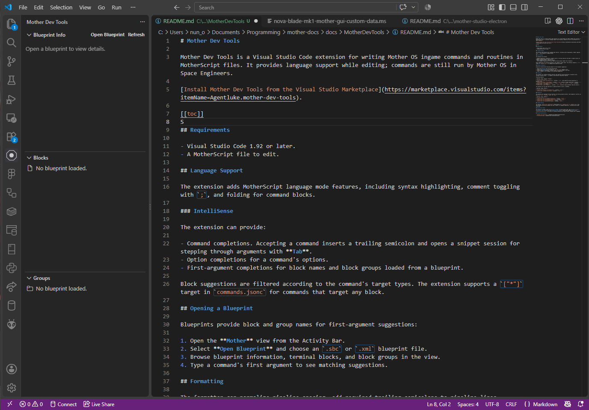
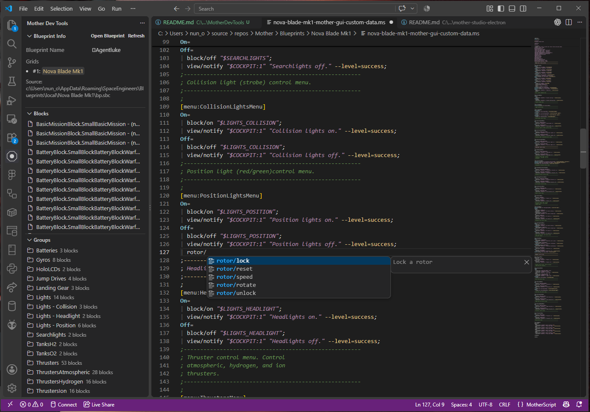
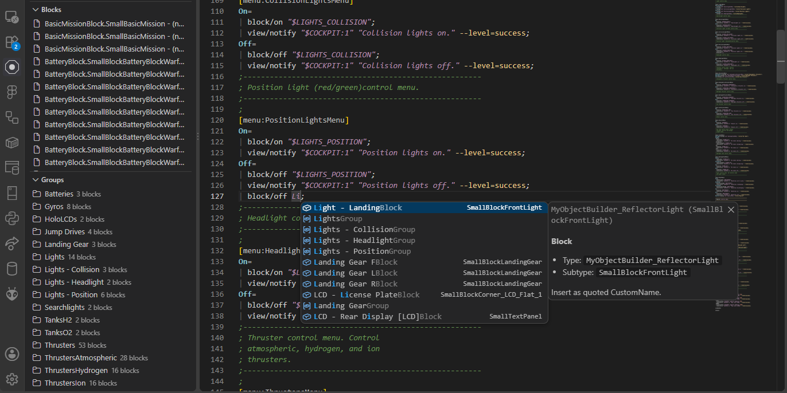

# Mother Dev Tools

[Install Mother Dev Tools from the Visual Studio Marketplace](https://marketplace.visualstudio.com/items?itemName=Agentluke.mother-dev-tools).

Mother Dev Tools is a [Visual Studio Code](https://code.visualstudio.com/) extension for writing Mother OS ingame commands and routines in MotherScript files. It provides language support while editing scripts in a an approachable code editor.

[[toc]]

## Requirements

- Visual Studio Code 1.92 or later.
- A MotherScript file to edit.

## Language Support

The extension adds MotherScript language mode features, including syntax highlighting, comment toggling with `;`, and folding for command blocks.

### IntelliSense

The extension can provide:

- Command completions. Accepting a command inserts a trailing semicolon and opens a snippet session for stepping through arguments with **Tab**.
- Option completions for a command's options.
- First-argument completions for block names and block groups loaded from a blueprint.

Block suggestions are filtered according to the command's target types. The extension supports a `["*"]` target in `commands.jsonc` for commands that target any block.

## Opening a Blueprint

Blueprints provide block and group names for first-argument suggestions:

1. Open the **Mother** view from the Activity Bar.
2. Select **Open Blueprint** and choose an `.sbc` or `.xml` blueprint file.
3. Browse blueprint information, terminal blocks, and block groups in the view.
4. Type a command's first argument to see matching suggestions.

**Command autocompletion**

**Blocks and Groups intelligence**

## Formatting

The formatter can normalize pipeline spacing, add required trailing semicolons to pipeline lines, configure spacing around `=` in headers, and normalize flag/option spacing.

Formatting options:

| Setting | Type | Default | Purpose |
| --- | --- | --- | --- |
| `motherscript.format.ensureSemicolons` | boolean | `true` | Add required trailing semicolons to pipeline lines. |
| `motherscript.format.normalizePipes` | boolean | `true` | Enforce a single space after a leading `|`. |
| `motherscript.format.spaceAroundEquals` | `"none"`, `"both"`, or `"after"` | `"none"` | Configure spacing around `=` in headers. |
| `motherscript.format.flagSpacing` | boolean | `true` | Normalize spacing between flags and options. |

The extension can also add semicolons or pipeline markers on save, if enabled:

| Setting | Type | Default |
| --- | --- | --- |
| `motherscript.fixOnSave.ensureSemicolons` | boolean | `false` |
| `motherscript.fixOnSave.ensurePipes` | boolean | `false` |

## Diagnostics

The extension can highlight missing semicolons and missing pipeline markers. Each diagnostic severity can be set to `error`, `warning`, `hint`, or `info`.

| Setting | Type | Default |
| --- | --- | --- |
| `motherscript.lint.missingSemicolonSeverity` | string | `"error"` |
| `motherscript.lint.highlightMissingSemicolon` | boolean | `true` |
| `motherscript.lint.missingPipeSeverity` | string | `"error"` |
| `motherscript.lint.highlightMissingPipe` | boolean | `true` |

## Command Catalog

The optional `motherscript.catalog.path` setting points to a `commands.json` or `commands.jsonc` file. This catalog can describe commands and their targets for language completions, including block-target filtering.

## MotherScript Theme

The extension includes a dark **MotherScript Theme**. In Visual Studio Code, open **Command Palette → Preferences: Color Theme** and select **MotherScript Theme**. Themes apply globally; use `editor.tokenColorCustomizations` if you want to customize MotherScript scopes without changing other languages.

## Related Documentation

- [Command Line Interface](../IngameScript/CommandLineInterface.md)
- [Troubleshooting](../IngameScript/Troubleshooting.md)
