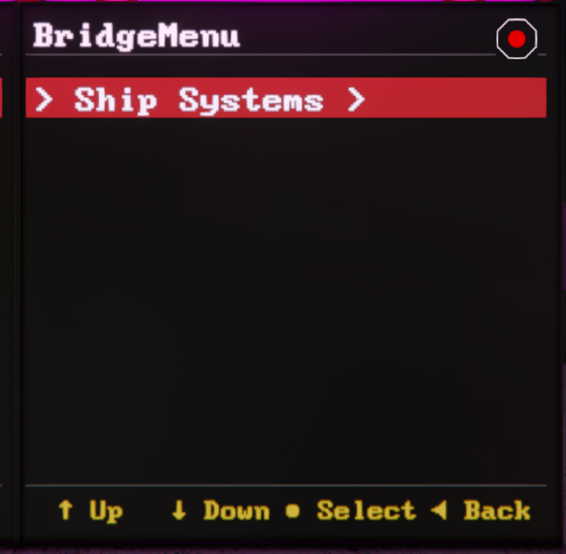
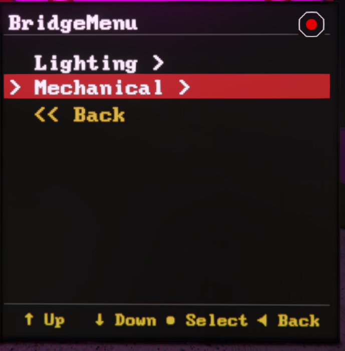
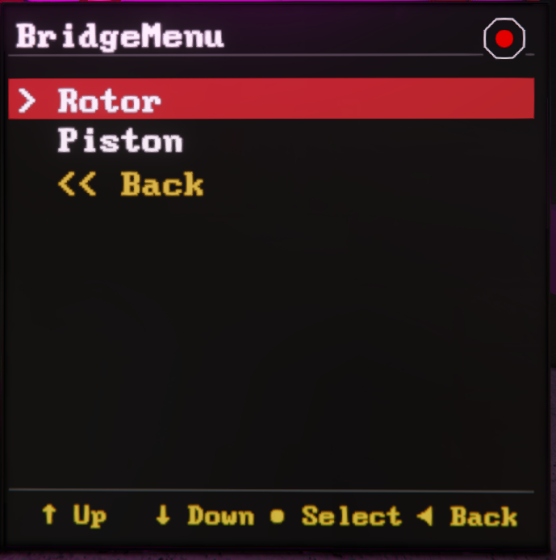
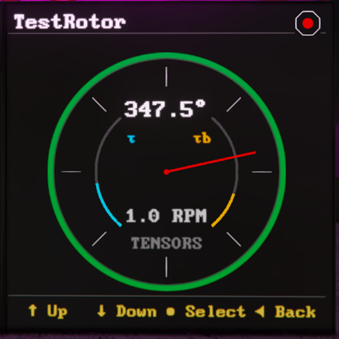
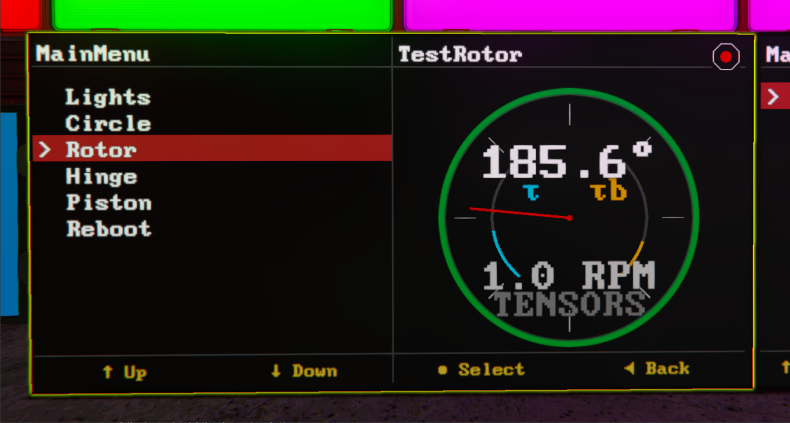

# MenuView

Menus are the core interaction model in Mother GUI. It turns any supported text surface into a navigable control panel backed by `Custom Data`, so you can build ship dashboards, engineering menus, and local control consoles without writing a custom renderer.

[[toc]]

## How Menus Work

A screen can:

- render a menu defined on the Mother GUI programmable block
- render indicator views like `RotorView`, `PistonView`, or `DoorView` for common mechanical blocks
- switch between menus and preserve navigation history
<!-- - render an inline menu defined directly on a display block -->

## Minimal Setup

Start by assigning a surface to a menu name. Custom menus live on the Mother GUI programmable block and use `[menu:MenuName]` sections.

```ms title="Bridge LCD > Custom Data"
[surfaces]
0=MainMenu
```

Then define that menu in the Mother GUI programmable block.

```ms title="Mother GUI > Custom Data"
[menu:MainMenu]
Mechanical=
.Power Menu=view/go self PowerMenu
.Hangar Door=view/go self "DoorView" "Hangar Door"

[menu:PowerMenu]
...
```

When the surface is discovered, Mother GUI resolves `MainMenu` from the custom data.

## Nested Menu Syntax

Menu depth is defined with leading dots. Every line still needs an `=` so the INI parser keeps it.

```ms title="Nested Menu Example"
[menu:EngineeringMenu]
Power=
.Reactors=
..Main On=block/on Main Reactor
..Main Off=block/off Main Reactor
.Batteries=
..Charge=battery/charge Main Batteries
..Auto=battery/auto Main Batteries

Mechanical=
.Lift=view/go self "PistonView" "Lift Piston"
.Ramp=view/go self "RotorView" "Ramp Rotor"
```

This creates the following menu structure:

```plaintext title="Menu Outline"
Ship Systems /
    |-- Lighting /
        | -- Red Alert
        | -- Clear Alert
    |-- Mechanical /
        | -- Rotor
        | -- Piston
``` 

|||
|--|--|
|||
|||

Lines with children behave like groups. Lines without children behave like selectable commands.


## Duplicate Labels

If two entries under the same menu need the same label, give each key a hidden internal id.

```ms title="Duplicate Labels"
[menu]
Light 1=
.1:Red=light/color MenuLight1 red
.2:Green=light/color MenuLight1 green

Light 2=
.3:Red=light/color MenuLight2 red
.4:Green=light/color MenuLight2 green
```

The `1:`, `2:`, `3:`, and `4:` prefixes satisfy the INI key requirements but are not intended as player-facing labels.

## Opening Views From Menus

Menu entries often launch another view instead of running a direct block command.

```ms title="Open Live Views From MenuView"
[menu:MainMenu]
Mechanical=
.Ramp=view/go self "RotorView" "Ramp Rotor"
.Lift=view/go self "PistonView" "Lift Piston"
.Airlock=view/go self "DoorView" "Outer Airlock Door"
```

Using `self` matters here. It tells Mother GUI to target the display that triggered the selection, so the same menu can be reused on multiple displays without hardcoding block names.

## Switching Menus

We use the `view/go`command to navigate between menus:

```ms title="Cross-Menu Navigation"
[menu:MainMenu]
Lighting=menu/go self LightMenu
Power=menu/go self PowerMenu

[menu:LightMenu]
All On=block/on Lights
All Off=block/off Lights

[menu:PowerMenu]
Reactors On=block/on Reactors
Reactors Off=block/off Reactors
```

Mother GUI preserves menu history across these jumps, so `view/back` can return the player to the previous menu state instead of always resetting to the root.

## Path Navigation

If you need to jump directly into a nested group, use a menu path, we can separate levels with `>`.

```ms title="terminal"
view/go "Bridge LCD" "EngineeringMenu > Power > Reactors";
```

This is useful for button-triggered shortcuts that should land directly inside a deeper branch.

## Back and Scrolling

Every menu that has somewhere to return to shows a `< Back` entry as its last item. This includes nested groups, as well as the root of a menu you reached from another menu or view. Select it, or run `view/back`, to return to the previous step.

That means most displays only need three inputs: `view/up`, `view/down` and `view/select`.

<!-- When a menu has more items than fit on the display, a `^` indicator appears when there are items above the visible list, and a `v` indicator appears when there are items below. -->

## Custom Titles

The menu header shows the menu name by default. Use the `title` option of `view/go` to show something else.

```ms title="terminal"
view/go "Cockpit:1" MapMenu --title="Map Menu Title";
```

The title resets when the player navigates into or out of a group.

## Notifications

Use [`view/notify`](./Commands.md#view-notify) to show a short message in the footer of a display. Notifications work in menus but will be expanded to other views soon. They clear automatically after a few seconds.

```ms title="Mother GUI > Custom Data"
[menu:MainMenu]
Lights=
.On=
| block/on "Interior Lights";
| view/notify self "Lights on" --level=success;

.Off=
| block/off "Interior Lights";
| view/notify self "Lights off";
```

Notification levels are `info`, `success`, `warning` and `error`.


## Widescreen Behavior

On widescreen displays, `MenuView` stays visible on the left while the selected live view is rendered in a side panel on the right. On smaller displays, the selected view replaces the menu until the player uses `view/back`.

That split-view behavior is what makes bridge LCDs especially good for Mother GUI. The menu remains usable while the right side becomes a live detail panel.



## Navigation Commands

The main commands to interact with a view are:

- `view/up`
- `view/down`
- `view/select`
- `view/back`
- `view/go`
- `view/notify`