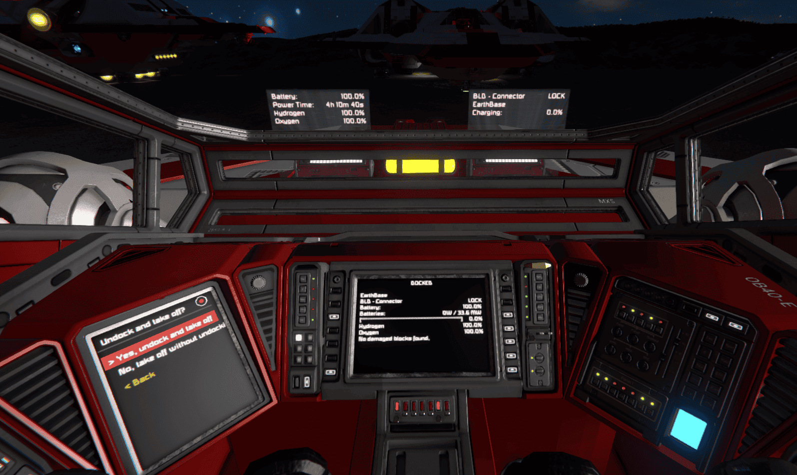

# Nova Blade Mk1

The Nova Blade Mk1 is a demonstration aircraft for the synergy of [Mother OS](../../IngameScript/IngameScript.md), [Mother GUI](../../MotherGUI/README.md) and [Mother Autopilot System (MAPS)](../../MotherAutopilotSystem/README.md) and [community-created scripts](../../PoweredByMother.md), all built using the [Mother Core](../../Framework/README.md) framework.

[](https://steamcommunity.com/sharedfiles/filedetails/?id=3823300552)


[Watch the Tech Demo](https://www.youtube.com/watch?v=9wHAGA4ow1E)

## Design Overview

We will walk through every cockpit menu, then follow a single button press through Mother OS, Mother GUI, MAPS and [Automatic LCDs 2](https://steamcommunity.com/sharedfiles/filedetails/?id=822950976) to see how they cooperate.

::: info Versions
The cockpit is built for **Mother OS 1.3.0**, **Mother GUI 0.3.0** and **MAPS 0.3.0**, all on [Mother Core](../../Framework/README.md) 1.2. The Custom Data shown here is trimmed from the Nova Blade configuration. Block and group names use the `BLD -` prefix.
:::

::: warning Work in progress
The Nova Blade is still being flown and tuned. Behaviour described here matches the current Custom Data, but some details (thresholds, wording, menu order) may change before release. Mother HMI is not covered in this post.
:::

[[toc]]

## The Goal

A pilot flying a ship with a dozen block groups should not have to remember which ones to switch on for takeoff, or which ones to turn off after landing. The cockpit has three jobs:

1. **Declare the ship's state.** Choosing a flight mode sets every flight-relevant block, so the ship is in a known configuration no matter what it was doing before.
2. **Give manual control of everything.** Any system a pilot might need to override has a menu entry and a way to see its state.
3. **Assist without taking over.** The ship warns, suggests and protects. It never silently changes the mode you picked.

Those principles shaped every decision below.

## Who Does What

Four scripts share the cockpit. Each does one job, and none of them draws or decides what another one owns.

```text
                       ┌────────────────────────────────┐
   Pilot ───────────►  │ Mother GUI                     │
   (menu screen)       │ menus, confirm prompts         │
                       └───────────────┬────────────────┘
                                       │ calls commands (ModeTakeoff, _Prompt, ...)
                                       ▼
 ┌─────────────────────────┐   ┌────────────────────────────────┐
 │ MAPS                    │   │ Mother OS                      │
 │ speed, altitude,        │──►│ flight mode, rules, indicator  │
 │ inspace, ingravity      │   │ lamp, AutoLCD views            │
 │ MapView                 │   └──────┬─────────────────┬───────┘
 └────────────┬────────────┘          │ autolcd/print   │ block commands
              │ MapView               ▼                 ▼
              │               ┌──────────────────┐   ┌─────────────────┐
              └─────────────► │ Automatic LCDs 2 │   │ Ship blocks     │
               (main screen)  │ draws live text  │   │ (thrusters,     │
                              └──────────────────┘   │ gear, lights..) │
                                                     └─────────────────┘
```

| Script | Role on the Nova Blade | Owns |
|---|---|---|
| **Mother OS** | The brain. Runs every flight-mode command, every rule, the indicator lamp and the display views. | `FLIGHT_MODE`, lamp state, `[commands]`, `[rules]`, `[autolcd]` |
| **Mother GUI** | The pilot's interface. Draws the menu on the cockpit's left screen and calls Mother OS commands when you select an entry. | `[menu:...]` sections |
| **MAPS** | The ship's senses. Answers `grid speed`, `grid altitude`, `grid inspace` and `grid ingravity`, draws the map and manages flight plans. | Ship conditions, `MapView` |
| **Automatic LCDs 2** | The system renderer. Draws live text (bars, percentages, lock states) from the views Mother OS prints for block stats. | Text on the main screen and HoloLCDs |

Mother does not talk to the other scripts through anything special. [Mother Core](../../Framework/README.md) shares commands, views and conditions across every programmable block on the construct, so a Mother GUI menu entry can run a command that only Mother OS defines, and a Mother OS rule can test a condition that only MAPS defines.

## The Cockpit Surfaces

Everything the pilot sees is one of five surfaces. Their size shaped the design more than anything else.

| Surface | Block | What it shows | Budget |
|---|---|---|---|
| **Menu screen** | `BLD - Cockpit [LCD]:1` | The Mother GUI menu, plus `view/notify` messages | About 6 entries visible, 7 at most per menu |
| **Main screen** | `BLD - Cockpit [LCD]:0` | A status view, the MAPS map, or the artificial horizon | About 12 lines of short text |
| **Left HoloLCD** | `BLD - HoloLCD 1 [LCD]` | Flight telemetry, or power and fuel when parked | 4 lines |
| **Right HoloLCD** | `BLD - HoloLCD 2 [LCD]` | Mode-specific status | 4 lines |
| **Indicator lamp** | `BLD - Lights - Warning` | One colour and blink pattern for anything that needs attention | One signal |



Some UX principles to keep in mind as you build your interfaces:

- **Keep menus shallow.** No menu has more than 7 entries. The original Main Menu had 15 and needed scrolling past the first screen.
- **A menu that changes a system also shows it.** The menu screen is small, so when you open a system menu the main screen swaps to a read-out for that system, and when the user changes something, show them a [notification](./../../MotherGUI/MenuView.md#notifications) so they know it happened.

## Cockpit Menu Controls

### How a Menu Entry Works

Menus live in the [Mother GUI](./../../MotherGUI/README.md) programmable block's Custom Data. Each `[menu:Name]` section is a screen of entries, and each entry is a routine. A `.` prefix nests an entry one level down.

```ms title="Mother GUI > Custom Data"
[menu:ControlsMenu]
Dampeners=
| view/go self DampenersMenu --title="Dampeners";
Landing Gear=
| view/go self LandingGearMenu --title="Landing Gear";
```

Most entries do one of three things:

- **Open another menu** with `view/go self <Menu> --title="..."`. `self` means this screen.
- **Change a block** with a [Mother OS](./../../IngameScript/IngameScript.md) block command such as `block/on`, `gear/lock` or `tank/stockpile`.
- **Call a Mother OS command** such as `ModeTakeoff`. Mother GUI has no idea how a mode works. It just asks.

Every action that changes a block ends with `view/notify`, which prints a short confirmation on the menu screen. That is how the pilot knows the press worked without looking away.

```ms title="Mother GUI > Custom Data"
[menu:DampenersMenu]
On=
| dampeners/on;
| view/notify $MENU_SCREEN "Dampeners on." --level=success;
```

`$MENU_SCREEN` and the other `$NAMES` come from the `[variables]` section, so the block list is edited in one place. Mother GUI and Mother OS keep an identical block list.

### The Main Menu

The Main Menu has seven entries, the limit we set ourselves. The most-used actions are at the top.

```text
Main Menu
├─ Flight      flight modes (one press from the top)
├─ Display     what the main screen shows, theme, HoloLCDs
├─ Controls    manual control of what you fly by hand
├─ Power       batteries and the reactor
├─ Tanks       hydrogen and oxygen tanks
├─ Lights      every light group, plus the lamp test
└─ Systems     everything else
```

Flight is a Mother OS command (`GoToFlight`) rather than a direct menu link. Mother GUI cannot read the current flight mode, so it asks Mother OS, which opens the Flight menu, or the Off menu with **Wake** if the ship is powered down.

### Flight

The Flight menu has one entry per mode, in the order a flight happens. See [Flight Modes](#flight-modes) for what each one does.

| Entry | Runs | Notes |
|---|---|---|
| Cruise > Atmosphere | `ModeCruiseAtmo` | Asks first if you are in space |
| Cruise > Space | `ModeCruiseSpace` | Asks first if you are in a gravity well |
| Takeoff | `ModeTakeoff` | Asks first if the connector or gear is locked |
| Landing | `ModeLanding` | |
| Docked | `ModeDocked` | Locks the connector if it is in range |
| Parked | `ModeParked` | Refused unless the gear is locked |
| Off | `_Prompt` | Opens "Power everything off?" with **No** listed first |

While the ship is **Off**, the entry is replaced by a one-entry **Off menu** with **Wake**.

### Display

Display chooses what the main cockpit screen shows. The choice lasts until the next mode change, when the mode picks its own default.

| Entry | Result |
|---|---|
| Status | The text view for the current mode |
| Map | The MAPS `MapView` |
| Horizon | The `TSS_ArtificialHorizon` script surface |
| Checks | A self-check (see [Self-Checks](#self-checks)) |
| Map Scale | 100 m, 200 m, 500 m or 1000 m, written to the cockpit's `general.mapScale` |
| Theme | **Day** (white, full brightness) or **Night** (red, lamp at 30%) |
| HoloLCDs | All on, all off, or open the left or right display |

### Controls

Controls holds the things you fly by hand. Every entry opens a small menu of **Toggle**, **On** and **Off** (and more where it makes sense).

| Menu | Entries |
|---|---|
| Dampeners | Toggle, On, Off |
| Handbrake | Toggle, On, Off |
| Gyros | On, Off |
| Landing Gear | Toggle, Lock, Unlock, On, Off |
| Connector | Lock, Unlock, Toggle, On, Off |
| Thrusters | Atmospheric, Hydrogen, Ion, each with Toggle, On, Off |

You can use [conditional logic](../../IngameScript/ConditionalLogic.md) to check the state of a block before acting, then tell the user what it did. The same pattern is used for the light groups, the reactor, the projectors, the turret, the antenna and the HoloLCDs.

```ms title="Mother GUI > Custom Data"
[menu:DampenersMenu]
Toggle=
| if $COCKPIT dampeners == 1;
|   dampeners/off;
|   view/notify $MENU_SCREEN "Dampeners off." --level=success;
| else;
|   dampeners/on;
|   view/notify $MENU_SCREEN "Dampeners on." --level=success;
| end;
```

Locking is the one place a quiet failure would be dangerous, so the entries report why they did nothing - lock attempts should always provide feedback:

```ms title="Mother GUI > Custom Data"
[menu:LandingGearMenu]
Lock=
| if $LANDING_GEAR locked;
|   view/notify $MENU_SCREEN "Landing gear already locked." --level=success;
| elseif $LANDING_GEAR ready;
|   gear/lock $LANDING_GEAR;
|   view/notify $MENU_SCREEN "Landing gear locked." --level=success;
| else;
|   view/notify $MENU_SCREEN "Landing gear not ready to lock." --level=error;
| end;
```

`locked`, `ready` and `connected`/`connectable` are predicates Mother OS registers for gear and connectors. The connector menu works the same way, replying "Connector not in range." when there is nothing to lock to.

Opening the Thrusters menu also switches the main screen to a matching status display. Mother GUI handles the menu and the main screen follows.

### Power

| Entry | Does |
|---|---|
| Auto, Recharge, Discharge | Sets the battery mode with `battery/auto`, `battery/charge` or `battery/discharge` |
| On, Off | Switches the batteries |
| Reactor | Toggle, On, Off |

Opening Power also switches the main screen to a power display.

### Tanks

Hydrogen and Oxygen each offer **Share**, **Stockpile**, **On** and **Off**. *Share* lets tanks supply other blocks. *Stockpile* makes them fill only and hold their fuel. Opening Tanks switches the main screen to a tank display.

### Lights

| Entry | Light group |
|---|---|
| Searchlights, Collision, Position, Headlight | Each with Toggle, On, Off |
| Warning | **Auto** (hand the lamp back to Mother OS), **On** (steady white), **Off**, Lamp Test |
| Lamp Test | Steps the indicator lamp through every colour and pattern |

Opening Lights also prints the lights status on the main screen. There is no "all lights" group, deliberately. A group holding every light on the ship would include the warning lights, which only the indicator lamp is allowed to switch.

### Systems

| Menu | Entries |
|---|---|
| Jump Drive | On, Off (also shows charge and time to full) |
| Antenna | Toggle, On, Off |
| Sensors | On, Off |
| Projector | Landing, Blueprint, All Off |
| Gatling Turret | Toggle, On, Off |
| Utilities | Purge Storage, Purge Almanac, Halt, Reboot, Lamp Test, Reset Lights, Force Mode |

**Utilities** is maintenance. *Reboot* restarts every Mother script on the grid (Mother OS sends `boot` to the Mother GUI and MAPS programmable blocks). *Reset Lights* restores the collision-light strobe settings.

**Force Mode** runs a flight mode without its safety checks, for when a check is wrong or the mode is out of sync with the grid. It calls the inner helper of each mode (`_Dock`, `_Park`, `_Takeoff`, `_CruiseAtmo`, `_CruiseSpace`, `_GoOff`) and skips the questions.

### Confirm Menus

Anything the ship asks you is a **two-entry menu**. There is no special prompt widget; a question is just a menu with a title, so you answer it with the same controls as everything else.

```ms title="Mother GUI > Custom Data"
[menu:ConfirmOffMenu]
No, cancel=
| _PromptEnd;
| view/go self FlightMenu --title="Flight Menu";
Yes, power everything off=
| _PromptEnd;
| ModeOff;
```

A question starts in one of two ways, and both go through the same Mother OS helper, `_Prompt`. It takes the confirm menu to open and a title.


**The pilot asks for something risky.** The Flight menu's **Off** entry does not power anything down. It opens the question:

```ms title="Mother GUI > Custom Data"
[menu:FlightMenu]
Off=
| _Prompt --menu=ConfirmOffMenu --title="Power everything off?";
```

The `parked` rule offers switching to the Parked mode after the landing gear has been locked for 2 seconds while Landing:

```ms title="Mother OS > Custom Data"
parked=
| when $LANDING_GEAR locked --for=2 --cooldown=10;
| if $FLIGHT_MODE == landing;
|   view/notify $MENU_SCREEN "Gear locked. Switch to Parked?" --level=info;
|   _Prompt --menu=ConfirmParkedMenu --title="Switch to Parked?";
| end;
```

In both cases `_Prompt` turns the indicator lamp orange and opens the menu on the cockpit's menu screen. Whatever the pilot chooses, the first step of the entry is `_PromptEnd`, which clears the lamp. [One Question at a Time](#one-question-at-a-time) shows what `_Prompt` does inside.

Some Tips:

- **Irreversible choices list *No* first** (Off, Purge Storage, Purge Almanac, Halt) so a stray press cancels. Suggestions list Yes first.
- **The lamp shows an open question.** While a confirm menu is open the indicator lamp is flashing orange. Answering clears it. If you leave with `Back`, Mother OS clears it by itself after 30 seconds.

## Flight Modes

The cockpit is organised around seven modes. All of the logic is in **Mother OS**, so a mode cannot drift between two scripts. The menu only calls it.

| Mode | Intent |
|---|---|
| **Docked** | Held by the connector. Everything quiet, batteries charge with one kept on auto as a backup. |
| **Parked** | On the ground with locked gear. Dark and still, but the antenna and HoloLCDs stay on. |
| **Takeoff** | Everything on for maximum performance. The reactor stays off, thrusters and headlights on. |
| **Cruise - Atmosphere** | Atmospheric and hydrogen thrusters, ion off. Horizon on the main screen. |
| **Cruise - Space** | Hydrogen and ion thrusters, jump drive on so it charges. Map on the main screen. |
| **Landing** | Everything on, plus landing light, sensors and landing projector. Horizon on the main screen. |
| **Off** | Cold storage. Only the cockpit menu and one battery stay alive. |

### Building Modes From Helpers

The modes are long, but they are built from a few helpers that start with `_`. These are not menu entries; they are shared building blocks.

| Helper | Does |
|---|---|
| `_Silence` | Thrusters, gyros, dampeners, reactor, jump drive, all lights, sensors, projectors and the turret off |
| `_Stockpile` | Both gas tank groups stockpile |
| `_Hold` | Handbrake on, gear autolock off, tanks stockpile |
| `_PowerUp` | The base every flying mode shares: batteries auto, tanks share, gyros and dampeners on, handbrake off, antenna, collision and position lights and HoloLCDs on |
| `_Depart` | Records the new mode, and unlocks the gear if you were Docked or Parked |
| `_ShowMain` | Puts the right view on the main screen for the current mode |

So Parked is little more than this:

```ms title="Mother OS > Custom Data"
ModeParked=
| if $LANDING_GEAR locked;
|   _Park;
| else;
|   view/notify $MENU_SCREEN "Gear not locked. Lock it in Controls > Landing Gear." --level=error;
|   _Flash --color=orange;
| end;
_Park=
| _Silence;
| _Hold;
| block/on $ANTENNA;
| battery/auto $BATTERIES;
| block/on $HOLOLCDS_GROUP;
| var/set FLIGHT_MODE parked --save;
| var/set MAIN_DISPLAY status;
| _ShowMain;
| autolcd/print $HOLOLCD_LEFT PowerFuelView;
| autolcd/print $HOLOLCD_RIGHT ParkedStatusView;
| view/notify $MENU_SCREEN "Parked." --level=success;
| _Flash --color=green;
```

The split into `ModeParked` (the guard) and `_Park` (the work) is what makes [**Force Mode**](#systems) possible: it calls `_Park` directly.

`FLIGHT_MODE` is saved with `--save`, so the mode survives a script reboot.

### The Pilot Owns the Locks

No mode locks or unlocks the landing gear or the connector on its own, with a few narrow exceptions (Docked locks a connector that is in range, and the "Undock and take off?" question below). Leaving the ground or the station is never a side effect of choosing a mode. You lock and unlock from **Controls**, or typically with the `P` key, and the ship then asks whether to switch modes.

### Takeoff

Takeoff has the most branching, because it involves checking the status of the landing gear and connector to determine the appropriate action. 

We want to set the mode to `Takeoff`:

```text
ModeTakeoff
├─ if connector locked       ─► ask "Undock and take off?"
├─ if connector in range     ─► TakeoffRelease (no question)
├─ if landing gear locked    ─► ask "Undock and take off?"
└─ if nothing locked         ─► Takeoff
```

`TakeoffRelease` warns about low batteries or hydrogen, unlocks the gear and connector, switches the connector **off** so it cannot pull the ship back in, starts Takeoff, and switches the connector back on after 10 seconds.

### Guards Instead of Refusals

Modes warn and continue unless continuing would strand or damage the ship.

- **Parked** is refused without locked gear.
- **Off** is refused unless Docked or Parked. That's how you lose a ship!
- **Docked** locks a connector in range, or errors if there is none.
- **Cruise - Atmosphere** in space asks whether you meant Cruise - Space, and the reverse in a gravity well. The answer is a confirm menu with the corrected mode first. In practice you can usually just select the first option without thinking about it.

### Self-Checks

`Checks` on the Display menu is a quick audit. It lists only the blocks that disagree with the mode: thrusters, gyros and the reactor that are still *on* while Docked, Parked or Off, and thrusters, gyros and batteries that are *off* while flying. An empty list means the ship matches its mode. Automatic LCDs 2 supports filters like `Working {TG:$THRUSTERS} thruster:on` that print nothing when no block matches.

## The Indicator Lamp

A single warning lamp sits in the centre of the cockpit, between the two HoloLCDs, and stays visible whichever screen is showing. The warning lights on the hull belong to the same group, so anyone outside sees the same signal. Lights are off when they don't need your attention. Colour tells you what kind of event it is, and blink speed tells you how urgent it is.


Mother OS keeps a handful of flags (`ALERT_BATT`, `ALERT_H2`, `ALERT_O2`, `LOCK_GEAR`, `READY_GEAR`, `LOCK_CONN`, `READY_CONN`, `INDICATOR_PROMPT`) that rules set, and one helper, `_Indicator`, turns them into the lamp. The lamp reads the flags, not raw battery or tank levels, so it does not flicker.

| Priority | State | Lamp | Preview |
|---|---|---|---|
| 1 | Critical battery (any mode), oxygen (any mode but Off) or hydrogen (flying only) | Red, fast blink, full brightness |  |
| 2 | A short confirmation or refusal | Green or orange, fast, about 1.5 s |  <br><br>  |
| 3 | A question waiting on you | Orange, medium blink |  |
| 4 | Off mode | Dark | Lamp off |
| 5 | Gear or connector locked | Green, steady |  |
| 6 | Gear or connector ready to lock | Green, medium blink |  |
| 7 | Nothing to report | Dark | Lamp off |

The previews use the blink animations from the [Light Module](../../IngameScript/Modules/Extension/LightModule.md#blink). Critical alerts are never interrupted by a flash. Hydrogen only counts while flying, because docked and parked ships stockpile it on purpose.

### One Question at a Time

`_Prompt` raises the flag, opens the confirm menu and starts a 30 second timer. If the pilot leaves with `Back`, the timer clears the lamp. But if a second question has opened in the meantime, the first timer must not clear the second one's flag.


There is no arithmetic in Mother's routines, so each prompt gets an id by **appending a character** to a counter:

```ms title="Mother OS > Custom Data"
_Prompt=
| var/set INDICATOR_PROMPT 1;
| var/set LAMP_FLASH 0;
| var/set PROMPT_ID $PROMPT_IDx;
| _Indicator;
| view/go $MENU_SCREEN {{menu:FlightMenu}} --title="{{title:Choose}}";
| _PromptExpire --id=$PROMPT_ID;
_PromptExpire=
| wait 30;
| if $PROMPT_ID == {{id}};
|   var/set INDICATOR_PROMPT 0;
|   _Indicator;
| end;
```

Each prompt turns `PROMPT_ID` from `0` into `0x`, then `0xx`, and so on. The timer carries the value it started with and clears the lamp only if the counter still matches. It uses Mother's text compare, which was added to Core for this build.

## Rules: The Ship Pays Attention

Rules run about twice a second. A rule's steps after `when` run when its condition turns true, and the steps after `else` run when it turns false again. Three options keep a rule from flickering:

| Option | Meaning |
|---|---|
| `--for=s` | The condition must hold this long |
| `--buffer=n` | Reset only after the value passes the threshold by `n` |
| `--cooldown=s` | Minimum time before it can trigger again |

A rule may warn, suggest or protect, but it never changes the active mode's setup by itself. Suggestions open a confirm menu. The one automatic mode change is **Docked**.

| Rule | Condition | Does |
|---|---|---|
| `docked` | Connector locked for 1 s | Switches to Docked from any mode except Off. Suggests Takeoff when it unlocks. |
| `parked` | Landing gear locked for 2 s while Landing | Asks "Switch to Parked?". Suggests Takeoff if the gear unlocks while Parked. |
| `approach` | Altitude below 150 m (reset above 170 m) | In Takeoff or Cruise - Atmosphere, asks "Switch to Landing?" |
| `takeoffCruise` | Speed above 10 m/s for 10 s in Takeoff | Asks for the Cruise mode that fits (space or atmosphere) |
| `gravity`, `spaceEntered` | Entering a gravity well or leaving the atmosphere | Messages, and a suggestion to swap Cruise mode |
| `drifting` | Faster than 3 m/s while Docked or Parked with nothing locked | Suggests Takeoff |
| `lowBattery`, `lowPower` | Average charge under 20%, then under 10% | Warns, then turns HoloLCDs and searchlights off and sets the red lamp |
| `lowHydrogen`, `criticalHydrogen` | Under 25% (flight fuel warns early), then under 10% | Warns only while flying |
| `lowOxygen`, `criticalOxygen` | Under 15%, then under 10% | Warns in every mode except Off |
| `reactorBackup` | Batteries under 20% (back off above 80%) | Starts the reactor, only while flying |
| `weakThrust` | Atmospheric thrusters under 30% for 5 s | Switches hydrogen thrusters on |
| `cruiseLights` | Speed above 30 m/s in Cruise - Atmosphere | Headlights off, back on below 25 m/s |
| `gearLocked`, `connectorLocked`, `gearReady`, `connectorReady` | Lock changes | Sets the lamp flags and flashes green (lock) or orange (unlock) |
| `jumpReady` | Jump drive fully charged | Message, and a green flash in Cruise - Space |

Mother GUI has one rule of its own, `proximity`, which warns when a sensor detects something. It is the only rule that does not depend on the flight mode.

Notice how many rules ask questions about speed, altitude and gravity. Those come from **MAPS**.

### Rule Examples

Rules live in the `[rules]` section of the Mother OS Custom Data. These four are simplified from the Nova Blade configuration, and each shows a different part of a rule.

**Two-way rules.** `gearLocked` uses `else;` to run when the gear unlocks again. It sets the flag the [indicator lamp](#the-indicator-lamp) reads and flashes green when the gear locks and orange when it unlocks. The connector rules work the same way.

```ms title="Mother OS > Custom Data"
[rules]
gearLocked=
| when $LANDING_GEAR locked;
|   var/set LOCK_GEAR 1;
|   _Indicator;
|   _Flash --color=green;
| else;
|   var/set LOCK_GEAR 0;
|   _Indicator;
|   _Flash --color=orange;
```

**Predicates.** `low` and `critical` are battery predicates, so the rule needs no thresholds. The critical battery flag drives the red lamp, and it clears itself when the charge recovers.

```ms title="Mother OS > Custom Data"
criticalBattery=
| when $BATTERIES critical;
|   var/set ALERT_BATT 1;
|   _Indicator;
|   view/notify $MENU_SCREEN "Battery critical." --level=error;
| else;
|   var/set ALERT_BATT 0;
|   _Indicator;
```

**Hysteresis.** `approach` asks about landing below 150 m. `--buffer=20` keeps the rule from firing again until the ship has climbed back above 170 m, so skimming a hill does not spam the pilot with questions.

```ms title="Mother OS > Custom Data"
approach=
| when grid altitude < 150 --buffer=20;
|   if $FLIGHT_MODE == takeoff;
|     _Prompt --menu=ConfirmLandingMenu --title="Switch to Landing?";
|   end;
| end;
```

**Conditions from another script.** `takeoffCruise` waits until the ship has held more than 10 m/s for 10 seconds, then picks the question to ask. `grid speed` and `grid inspace` are answered by MAPS, and Mother OS does not need to know how.

```ms title="Mother OS > Custom Data"
takeoffCruise=
| when grid speed > 10 --for=10;
|   if $FLIGHT_MODE == takeoff;
|     if grid inspace;
|       _Prompt --menu=ConfirmCruiseSpaceMenu --title="Switch to Cruise - Space?";
|     else;
|       _Prompt --menu=ConfirmCruiseAtmoMenu --title="Switch to Cruise - Atmosphere?";
|     end;
|   end;
| end;
```

:::note AND + OR?
`And` and `Or` logical operators are not available yet but are likely to be added in a future update.
:::

## Displays: Automatic LCDs 2

Mother OS does not draw any text itself. When it runs `autolcd/print <screen> <view>`, it copies the named view from its `[autolcd]` section into that screen's Custom Data, and **Automatic LCDs 2** renders it and keeps it live. See the [AutoLCD module](../../IngameScript/Modules/Extension/AutoLCDModule.md) for the details.

For more on the script itself, see the [Automatic LCDs 2 Workshop page](https://steamcommunity.com/sharedfiles/filedetails/?id=822950976) and its [Full Guide](https://steamcommunity.com/sharedfiles/filedetails/?id=407158161).

```ms title="Mother OS > Custom Data"
[autolcd]
FlightStatusView=
| Center {{title:FLIGHT}}
| Echo
| PowerStoredX {TG:$BATTERIES} {Battery}
| TanksX {TG:$TANKS_H2} hydrogen {Hydrogen}
| TanksX {TG:$TANKS_O2} oxygen {Oxygen}
| PropBool {TG:$THRUSTERS_ATMOSPHERIC} {OnOff} {Atmo thrusters} {ON} {OFF}
| PropBool {TG:$THRUSTERS_HYDROGEN} {OnOff} {H2 thrusters} {ON} {OFF}
| PropBool {TG:$THRUSTERS_ION} {OnOff} {Ion thrusters} {ON} {OFF}
| Working {T:$PRIMARY_LANDING_GEAR}
| Working {T:$CONNECTOR}
| Dampeners
| PropBool {T:$COCKPIT} {HandBrake} {Handbrake} {ON} {OFF}
```

Lines like `PowerStoredX` and `TanksX` are Automatic LCDs 2 commands. They update continuously. The `$VARIABLES` and the `title` placeholder are resolved by Mother **once, at print time**. That is why the mode name appears as `autolcd/print $MAIN_SCREEN FlightStatusView --title=$FLIGHT_MODE` rather than a live lookup.

### Fitting Four Lines

The HoloLCDs have four lines, so a view cannot afford a line per block. Commands like `Working`, `EnabledCount` and `BlockCount` print one line per block, which is fine for a diagnostic on the main screen but ruinous on a HoloLCD. Where a group needs one line, a view reads the first block of the group with `PropBool`, which is representative because mode commands switch whole groups. Lock state uses a single reference block (`PRIMARY_LANDING_GEAR`, the nose gear) so it prints one short line.

### What Each Mode Shows

The two HoloLCDs always carry the essentials, which leaves the main screen free for something bigger.

| Mode | Main screen | Left HoloLCD | Right HoloLCD |
|---|---|---|---|
| Docked | `DockedView` (station, connector, charge, damage check) | Power and fuel | Connector, station, charging |
| Parked | `ParkedView` (battery, tanks, gear, damage check) | Power and fuel | Gear, autolock, handbrake, altitude |
| Takeoff | Flight status | Speed, altitude, gravity | Connector, gear, hydrogen, battery |
| Cruise - Atmosphere | Artificial horizon | Speed, altitude, gravity | Stop time and distance, hydrogen, battery |
| Cruise - Space | MAPS map | Speed, acceleration | Dampeners, stop time and distance, hydrogen, battery |
| Landing | Artificial horizon | Speed, altitude, gravity | Gear, connector, stop time and distance |
| Off | `OffView` ("Flight > Wake to power up") | Off | Off |

### One Helper, Three Sources

The main screen can show a text view, a MAPS map, or a TSS script such as the horizon. These are different systems that all want the same surface, so Mother OS has one helper, `_ShowMain`, that reads `MAIN_DISPLAY` (`status`, `map`, `horizon` or `checks`), clears whatever was there and shows the right thing.

```ms title="Mother OS > Custom Data"
_ShowMain=
| if $MAIN_DISPLAY == map;
|   autolcd/clear $MAIN_SCREEN;
|   view/go $MAIN_SCREEN MapView;
|   wait 1;
|   view/go $MAIN_SCREEN MapView;
| elseif $MAIN_DISPLAY == horizon;
|   autolcd/clear $MAIN_SCREEN;
|   screen/script $MAIN_SCREEN TSS_ArtificialHorizon;
| elseif $MAIN_DISPLAY == checks;
|   _ShowChecks;
| elseif $FLIGHT_MODE == docked;
|   autolcd/print $MAIN_SCREEN DockedView;
| ...
| end;
```

Every mode command calls it, and so does **Display**. The clearing logic exists once. `MapView` belongs to MAPS but is shown with Mother GUI's `view/go`, which is how a view owned by one script ends up on a surface drawn by another.

### Running Display Scripts

Some of the most dynamic cockpit displays are not text at all. A display surface can run a **script**, either one built into the game or one added by a mod. Mother GUI switches a surface into script mode and picks the script with a single command:

```ms title="terminal"
screen/script <Display> <ScriptName>
```

The Nova Blade uses it for the artificial horizon on the main screen:

```ms title="terminal"
screen/script "BLD - Cockpit [LCD]:0" TSS_ArtificialHorizon;
```

That is what the **Horizon** entry in the Display menu and the `horizon` branch of `_ShowMain` do. `TSS_ArtificialHorizon` is one of the scripts built into Space Engineers (the `TSS_` prefix stands for Text Surface Script). Other built-in scripts, such as `TSS_Velocity`, `TSS_Gravity` and `TSS_EnergyHydrogen`, are set the same way.

Mod-driven scripts work the same way. `RadioSpectrometer` is one popular example. Use its name exactly as the script reports it:

```ms title="terminal"
screen/script "BLD - Cockpit [LCD]:0" RadioSpectrometer;
```

You do not need to remember the names. `screen/scripts` switches a display to text mode and prints every script available on that surface, which is also the quickest way to check that a mod script is installed:

```ms title="terminal"
screen/scripts "BLD - Cockpit [LCD]:0";
```

A few things to know when mixing scripts with printed views:

- **A surface shows one thing at a time.** A script and an Automatic LCDs 2 view both want the same surface. That is why `_ShowMain` calls `autolcd/clear` before `screen/script`.
- **Target the surface, not just the block.** Cockpits have several surfaces, so use `Block Name:SurfaceIndex` as in `BLD - Cockpit [LCD]:0`.
- **`screen/content` sets the mode directly.** `screen/content <Display> <none|script|text>` changes the surface content type without choosing a script.

The same helper pattern applies. To offer the radio spectrometer, add a `MAIN_DISPLAY` value for it and another `elseif` branch to `_ShowMain` that clears the surface and runs `screen/script`. See [Mother GUI Commands](../../MotherGUI/Commands.md#screen-script) for the full script list.

## How the Scripts Talk

Following one press shows the whole system. Say the pilot picks **Flight > Takeoff** with the connector still locked.

1. **Mother GUI** runs the menu entry `ModeTakeoff`. It does not define that command. Mother Core finds the Mother OS programmable block that does and routes the call there.
2. **Mother OS** runs `ModeTakeoff`, tests `$CONNECTOR connected` and calls `_Prompt`.
3. The `_Prompt` helper raises the prompt flag, turns the lamp orange and runs `view/go $MENU_SCREEN ConfirmTakeoffReleaseMenu`. Mother OS is asking the *Mother GUI* to draw a menu that only Mother GUI owns.
4. The pilot answers **Yes**. **Mother GUI** runs the menu entry, which clears the prompt and calls `TakeoffRelease` in Mother OS.
5. **Mother OS** unlocks the blocks, runs `_TakeoffSet`, which calls `autolcd/print` for both HoloLCDs, and **Automatic LCDs 2** redraws them.
6. Once airborne, speed holds above 10 m/s for 10 seconds. The `takeoffCruise` rule, which tests `grid speed` and `grid inspace`, both answered by **MAPS**, asks the pilot to move to Cruise - Atmosphere or Cruise - Space.

Along the way nothing is copied between scripts. Mother Core carries commands, views and conditions across the construct.

### Variables Are Per Script

The most important lesson of the build: **a variable set in one script is invisible to another.** `var/set FLIGHT_MODE ...` writes to Mother OS's memory, and Mother GUI cannot read it.

That shaped the design:

- All state (`FLIGHT_MODE`, `MAIN_DISPLAY`, lamp flags, prompt ids) lives in **Mother OS**.
- Everything that depends on state (rules, helpers, mode commands) lives in **Mother OS**.
- Mother GUI contains only menus and one rule. Its entries call commands, never read the mode. That is also why **Flight** goes through `GoToFlight`, and why **Theme** calls an OS command: `LAMP_LEVEL` is an OS variable.
- The block name list is **duplicated**, and must stay identical in both files. It is the only thing the two files share.

### Helpers Live in One Place

Commands that start with `_` are helpers: not shown in menus, but callable. Every helper is defined in Mother OS, even though Mother GUI menus call several of them (`_Prompt`, `_PromptEnd`, `_Lamp`, `_Indicator`, `_Dock`...). Mother OS is the single owner of mode logic.


[Fly the Nova Blade Mk1](https://steamcommunity.com/sharedfiles/filedetails/?id=3823300552)
