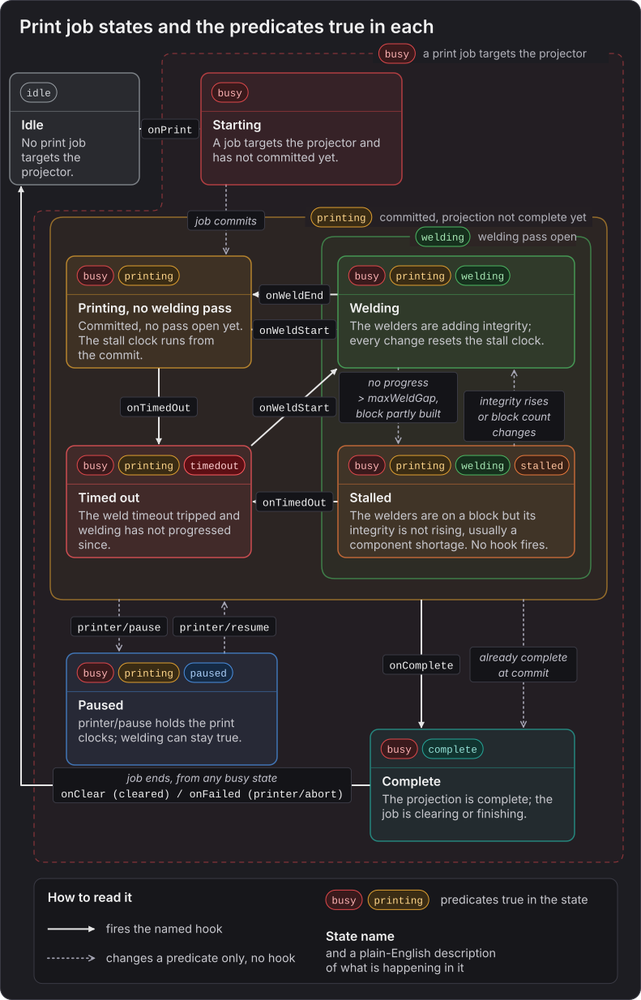

# Conditions

Mother Core 1.2.0 adds conditional logic: `when` rules that run a routine when a condition changes, and `if` steps that branch inside any routine. Printed by Mother gives projectors their own predicates and properties, such as `busy`, `stalled` and `progress`, so a condition can ask what a printer is doing. The rule syntax itself belongs to Mother Core and is described in [Conditional Logic](../IngameScript/ConditionalLogic.md).

[[toc]]

## Properties and Predicates

::: tip
A property is compared with an operator and a value (`progress > 50%`), while a predicate stands alone (`busy`). See [Conditional Logic](../IngameScript/ConditionalLogic.md#conditions) for the full condition syntax.
:::

They apply to projectors. The target is a projector's name, a group of projectors or a `#tag`, exactly as in the projector commands. Printer names and merge blocks are not targets.

| Predicate | True when |
|-|-|
| `idle` | No print job targets the projector. The opposite of `busy`. |
| `busy` | A print job targets the projector, in any phase: starting, printing, clearing or finishing. |
| `printing` | The job has committed and the projection is not complete yet (the `printing` phase). Stays true while the job is paused. |
| `paused` | The job is held by `printer/pause`, which works while starting, printing and clearing. See [Pausing a Job](./PrintJobs.md#pausing-a-job). |
| `complete` | The projection is complete and the job has not ended yet (the `clearing` and `finishing` phases). |
| `welding` | A welding pass is open on the projector: from `onWeldStart` until `onWeldEnd`, or until `onTimedOut` closes the pass. |
| `stalled` | The job is printing and not paused, a welding pass is open on a partly built block, and neither that block's integrity nor the projector's block counts have changed for longer than the projector's `maxWeldGap`. The welders are on a block but cannot finish it, usually because components ran short. False once the weld timeout has tripped. |
| `timedout` | The weld timeout has tripped (`onTimedOut` fired) and welding has not progressed since. |

| Property | Description |
|-|-|
| `progress` | The share of the projection that is placed, from `0` to `1`: `1 - remaining / total`. Has no value when nothing is projected. |
| `remaining` | The projector's remaining block count. `0` when nothing is projected. |
| `printtime` | Seconds welded in this print, the same figure `projector/status` shows. `0` when no job targets the projector. |

Every predicate except `idle` is also a property that is `1` or `0`, so `"Bay 1 Projector" busy` and `"Bay 1 Projector" busy == 1` mean the same. Write ratios as percentages: `"Bay 1 Projector" progress > 50%`.



An arrow that leaves a frame stands for the same arrow from every state inside it. What the drawing does not show:

- `busy` is true in every state except Idle. `busy` and `idle` follow the projector's own job, not its printer: when two projectors share a printer and one of them prints, the other is still `idle`. To ask whether a printer is busy, use a group of its projectors.
- `welding` and `timedout` follow the projector rather than the job, so both also turn false when the projection is removed.
- `onComplete` can also come from the job's completion check with no welding pass open. A projection that is already complete when the job commits goes straight to Complete without `onComplete`. See [Stalls and Failures](./PrintJobs.md#stalls-and-failures).
- For a group, a predicate is true when **any** projector in the group matches, and a property is the **average** of the projectors that have a value. A projector with nothing projected has no `progress` and is left out, but counts as `0` in `remaining`.
- `progress` and `remaining` count placed blocks, so they can reach `100%` and `0` a little before `onComplete`. Use `complete` to know that the print is finished.

## Using Conditions

Rules live in the `[rules]` section of a Mother programmable block's Custom Data: the Printed by Mother programmable block, or any other Mother programmable block on the construct. The first step of a rule is `when`; the steps after it run when the condition becomes true, and the steps after an optional `else;` run when it becomes false again. `if`, `else` and `end` work in any routine, including `[commands]` entries and hooks.

### Bay Lights and Doors

The bay lights and door follow the projector. The `else` branch puts them back when the job ends, however it ends.

```ms title="Printed by Mother > Custom Data"
[rules]
Bay1Busy=
| when "Bay 1 Projector" busy;
|   light/color "Bay 1 Lights" yellow;
|   door/close "Bay 1 Door";
| else;
|   light/color "Bay 1 Lights" white;
|   door/open "Bay 1 Door";
```

### A Stall Notice

`stalled` turns true when the welders are on a block whose integrity has not risen for longer than `maxWeldGap`, which usually means they ran out of components. `--for=30` waits until the stall has lasted 30 seconds, so a short wait for an assembler does not raise the notice. A stall lasts only until the projector's `timeout` trips, so the wait needs a longer `timeout` than the default 15 seconds, which ends a stall after about 12. Give the welders time to be resupplied, for example with `projector/settings "Bay 1 Projector" --timeout=300 --save;`.

```ms title="Printed by Mother > Custom Data"
[variables]
SCREEN="Bay Control:0"

[rules]
Bay1Stalled=
| when "Bay 1 Projector" stalled --for=30;
|   view/notify $SCREEN "Bay 1 is short of components." --level=warning;
```

`view/notify` comes from a [Mother GUI](../MotherGUI/README.md) programmable block on the construct. Unlike `onTimedOut`, the rule warns while the welders are still on the block, before the projector's `timeout` gives up on it. A print whose welders never start does not stall; catch that with `onTimedOut`, or with `printing` and `--for`. See [Stalls and Failures](./PrintJobs.md#stalls-and-failures).

### Halfway and Long Prints

```ms title="Printed by Mother > Custom Data"
[rules]
Bay1Halfway=
| when "Bay 1 Projector" progress > 50%;
|   screen/print "Bay 1 Status" "Bay 1 is halfway.";

Bay1Long=
| when "Bay 1 Projector" printtime > 1800 --cooldown=600;
|   screen/print "Bay 1 Status" "Bay 1 has been welding for 30 minutes.";
```

`Bay1Halfway` runs when the share of placed blocks passes half, and becomes ready again once nothing is projected. `Bay1Long` runs when a print has welded for 30 minutes; `--cooldown=600` keeps it from running again within 10 minutes of the last time.

### Only Print into an Idle Bay

`blueprint/print` into a busy printer fails with an error. An `if` step can check first and say why instead.

```ms title="Printed by Mother > Custom Data"
[variables]
SCREEN="Bay Control:0"

[commands]
StartBay1=
| if "Bay 1 Projector" idle;
|   blueprint/print "Bay 1 Projector";
| else;
|   view/notify $SCREEN "Bay 1 is busy." --level=warning;
| end;
```

## Hooks Versus Rules

[Hooks](./Hooks.md) and rules both react to a print, in different ways:

- A hook fires once, at the moment something happens, inside Printed by Mother. `onWeldStart`, `onWeldEnd`, `onTimedOut` and `onComplete`, and the job hooks `onLoad`, `onPrint`, `onClear` and `onFailed`, are events.
- A rule watches a state. Its `else` branch runs on the way back, `--for` ignores a state that does not last, `--cooldown` limits how often it runs, and the rule can sit in another script's Custom Data.

Use a hook for a step of the print itself, such as switching the welders on in `onPrint`. Use a rule for anything that should follow the printer's state for as long as it lasts, such as lights, doors and screens.

## Predicates from Other Scripts

Every Mother script on a construct shares its predicates and properties with the others, so the projector's predicates work in the rules of Mother OS and Mother GUI with nothing to register, and Printed by Mother's rules can use theirs. See [Shared Vocabulary](../IngameScript/ConditionalLogic.md#shared-vocabulary).

On the Printed by Mother programmable block, a rule can hold the print while Mother OS reports the batteries low:

```ms title="Printed by Mother > Custom Data"
[variables]
BATTERIES=Batteries

[rules]
Bay1Power=
| when $BATTERIES low --for=5;
|   printer/pause bay-1;
| else;
|   if "Bay 1 Projector" paused;
|     printer/resume bay-1;
|   end;
```

`low` is a Mother OS battery predicate. The `if` matters: `printer/resume` commits a job that is still starting, so the rule only resumes a job that is paused. A pause stops the print clocks, not the welders; see [Pausing a Job](./PrintJobs.md#pausing-a-job).

On a Mother GUI programmable block, a rule can follow every printer on the construct:

```ms title="Mother GUI > Custom Data"
[rules]
PrintersBusy=
| when "Printers" busy;
|   block/on "Hangar Beacon";
| else;
|   block/off "Hangar Beacon";
```

`Printers` is a group of the construct's projectors, so the beacon is on while any of them prints.

::: note
Update every Mother script on the construct to Mother Core 1.2.0 at the same time, so they share the same predicates and properties.
:::
